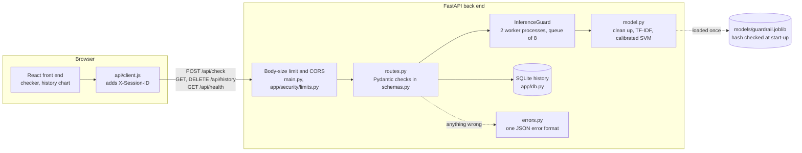

# Prompt Injection Guardrail

A web app that checks a message for prompt injection before it reaches a language model.
Paste in a message and it tells you whether it would be blocked or allowed, and how sure
the model is.

It's for developers who run a chatbot and want a check in front of it, and for anyone who
wants to test a suspicious message themselves. This is our Assignment 3 for COS30049
Computing Technology Innovation Project at Swinburne University of Technology. It takes the
classifier we built in Assignment 2, serves it from a FastAPI back end with a React front
end, and adds defences for the app itself.

## Team

Group 8, Session 7. Tutor: Ricky Dong.

| Name | Student ID | What they worked on |
|---|---|---|
| Sakada Seu | 105218002 | The API: routes, request and response models, error handling |
| Chyheang Chhour | 105078688 | The front end: design, layout and accessibility |
| Chanresmey Samrith | 105217889 | Security (sections 2.3 and 2.6 to 2.8), connecting the model to the API |

## Architecture



One check goes like this:

1. The front end checks the length and that the box isn't empty, then sends
   `POST /api/check` with the text and the tab's session ID.
2. The size limit refuses an oversized body before reading it. CORS only lets our own
   front end call the API from a browser.
3. Pydantic checks the text is 1 to 8,000 characters and the session ID is a UUID.
   Anything wrong gets a 422 from `errors.py`.
4. The text waits for one of the model's worker processes. If the queue is full, it gets
   a 503 with `Retry-After` instead.
5. In the worker, `model.py` cleans the text up with the same function used in training,
   turns it into word and character TF-IDF features, and asks the calibrated SVM for the
   chance it's an injection. 0.5 or above is blocked.
6. The result is saved to the history with a parameterised query and sent back as
   `{"id", "label", "confidence"}`. The front end shows it and reloads the history chart.

## What's where

| Path | What it is |
|---|---|
| `Backend/main.py` | Creates the app, adds the size limit and CORS |
| `Backend/routes.py` | The four API endpoints |
| `Backend/model.py` | Checks and loads the model, runs a prediction |
| `Backend/schemas.py`, `errors.py`, `config.py` | Request and response models, error responses, settings |
| `Backend/app/security/` | Settings, the request-size limit, and the worker pool that runs the model |
| `Backend/app/db.py` | The history of past checks (SQLAlchemy) |
| `Backend/app/model/normalise.py` | The clean-up step that undoes disguised text |
| `Backend/models/` | The trained model and its SHA-256 |
| `Backend/lab/` | Scripts that rebuild the model and run each attack with its defence off and on |
| `Backend/reports/` | The tables and figures those scripts produced |
| `Frontend/` | The React site (more detail in `Frontend/README.md`) |

## Running it locally

You need Python 3.13, Node.js 22 and git. Every dependency version is pinned, in
`Backend/requirements.txt` and `Frontend/package-lock.json`. Use two terminals.

**Back end**, from the `Backend` folder:

```
python -m venv .venv
.venv\Scripts\activate
pip install -r requirements.txt
python -m uvicorn main:app --port 8000
```

On macOS or Linux, activate with `source .venv/bin/activate` instead. A conda environment
with Python 3.13 works just as well. Start the server from inside `Backend`, because that's
where it looks for `.env` and creates the history database. Start-up takes a few seconds,
because each worker process loads its own copy of the model. Once it says
`Application startup complete`, the API docs are at http://localhost:8000/docs.

**Front end**, from the `Frontend` folder:

```
npm ci
npm run dev
```

Then open http://localhost:5173. Under "Check a prompt" it should say "Back end connected."
In development only, http://localhost:5173/crash-test deliberately crashes, to show the
fallback error page.

## API

Every endpoint except `/api/health` needs an `X-Session-ID` header holding a UUID. The front
end makes a new one for each browser tab, so a tab only ever sees its own history. The
full documentation, with an example for each endpoint, is at `/docs` while the server is
running.

| Request | Body | Response |
|---|---|---|
| `GET /api/health` | | `{"status": "ok", "model_loaded": true, "max_text_chars": 8000}` |
| `POST /api/check` | `{"text": "..."}`, 1 to 8,000 characters | `{"id": 12, "label": "blocked", "confidence": 0.998}` |
| `GET /api/history` | | `{"items": [{"id", "text", "label", "confidence", "created_at"}]}`, newest first, up to 50 |
| `DELETE /api/history` | | `{"deleted": 3}`. The front end calls this from "Clear history". |

`label` is `"blocked"` or `"allowed"`. `confidence` is how sure the model is of that label,
so a blocked message with confidence 0.998 had a 99.8% chance of being an injection, and an
allowed message with confidence 0.95 had a 5% chance.

Every error comes back in the same shape, including unexpected ones:

```json
{"error": {"code": "invalid_input", "message": "Message must not be blank."}}
```

| Status | Code | When |
|---|---|---|
| 413 | `payload_too_large` | The body is over the size limit (97,024 bytes by default). It's refused before it's read. |
| 422 | `invalid_input` | Missing or blank text, more than 8,000 characters, or a missing or invalid `X-Session-ID` |
| 404, 405 | `not_found`, `method_not_allowed` | An address or method the API doesn't have |
| 503 | `server_busy` | Every worker is busy and the queue is full. Comes with a `Retry-After` header. |
| 500 | `internal_error` | Something unexpected, such as the model failing. Details only go to the server log. |

## Settings

Everything can be changed with environment variables or a `Backend/.env` file. Copy
`.env.example` to `.env` to start; the defaults work without one.

| Variable | Default | What it does |
|---|---|---|
| `PIG_ALLOWED_ORIGIN` | `http://localhost:5173` | The one website allowed to call the API from a browser |
| `PIG_MAX_TEXT_CHARS` | `8000` | Longest message accepted. The front end reads it from `/api/health`. |
| `PIG_DATABASE_URL` | `sqlite:///./pig_history.db` | Where the history is stored |
| `PIG_HISTORY_LIMIT` | `50` | How many past checks `/api/history` returns |
| `PIG_INFERENCE_MODE` | `process` | Run the model in worker `process`es or `thread`s |
| `PIG_INFERENCE_WORKERS` | `2` | Predictions that can run at once |
| `PIG_INFERENCE_QUEUE` | `8` | Extra requests allowed to wait for a worker |
| `PIG_QUEUE_TIMEOUT_S` | `2.0` | Longest a request waits before getting a 503 |

The three `PIG_DEMO_DISABLE_...` switches each turn one defence off, so we could record the
"before" half of each demo. The server prints a warning when any of them is on. Leave them
off.

## Threat model

We built it around three questions (Shostack 2014). `SECURITY.md` has the full version.

**What are we building, and what's worth protecting?** A public API that runs a machine
learning model and keeps a history of what people checked. Three things matter: the
checker staying up for everyone, the verdicts and history not being tampered with, and the
privacy of what people paste in, which can include secrets.

**What can go wrong?** We assume the attacker skips the website, calls the API directly,
and sends anything, as often as they like. Our design exposes three risks:

- **SQL injection.** The history stores user text in a database.
- **Denial of service.** A model call is slow compared with a normal web request, and a
  large body costs memory to read.
- **Detection evasion.** An attacker can disguise an injection so the model doesn't
  recognise it.

Some common risks don't apply. There are no logins, so there's nothing to steal or bypass.
There are no cookies, so cross-site request forgery has nothing to use. User text is only
ever shown as text, never as HTML, so cross-site scripting has nowhere to run.

**What are we doing about it?** One defence for each risk, plus the hygiene below.

## Security

### Hygiene

- **User input is never rendered as HTML.** React escapes it, and nothing uses
  `dangerouslySetInnerHTML`.
- **Each input has its own limit.** Text is 1 to 8,000 characters (enough for 99.4% of the
  training prompts). The body is capped at 12 bytes per character plus 1 KB, the most one
  character can take in JSON. The session ID must be a UUID.
- **CORS lists the front end's exact origin**, and the setting refuses `*` or a trailing
  path.
- **No secrets in the repository.** Settings come from the environment or a git-ignored
  `.env`.
- **The model file is checked before it's loaded.** A joblib file is a Python pickle, and
  loading a pickle can run code (Python Software Foundation n.d.). `model.py` compares its
  SHA-256 with `models/guardrail.sha256` and refuses to start if they differ.

### The defences to be marked

| Defence | Section | Code | With the defence off | With it on |
|---|---|---|---|---|
| Parameterised SQL | 2.7 | `app/db.py` | 4 of 5 attacks worked, the 5th crashed the query | All 5 stored as plain text |
| Size limit, worker pool and admission control | 2.7 | `app/security/limits.py`, `inference.py` | 100 heavy requests took 8.3 to 9.1 s to clear; other users waited up to 8.3 s | Cleared in 1.8 to 1.9 s; other users waited 0.8 s at most |
| | | | A 100 MB request was read in full | Refused in 0.05 s, before reading |
| Text clean-up (detection evasion) | 2.8 | `app/model/normalise.py` | 80.1% of 7 new disguises got through Assignment 2's clean-up | 0.6% got through |

**SQL injection.** The vulnerable version pasted the message into the SQL text, so a quote
ended the string and the rest ran as SQL: one attack read every other user's messages, two
rewrote a blocked result as allowed. The fix passes the message as a parameter, separately
from the query (OWASP n.d.a), so it can only be stored as text. We didn't use a blocklist:
our tests showed a rule against `--` is beaten by `/*`. Results:
`reports/tables/sql_injection_direct.csv`.

**Denial of service.** FastAPI runs every request on one event loop, so a slow model call
on that loop holds everyone up. The model now runs in two worker processes with a queue of
eight. Anything beyond that, or anything waiting more than 2 seconds, gets an immediate 503
with `Retry-After` (OWASP n.d.b). The size limit refuses a body over the limit from its
`Content-Length` alone, and stops reading a body with no length once it passes the limit.
Results over five floods: `reports/tables/dos_summary_harness.csv` and
`reports/figures/fig2_dos_flood.png`.

What it costs, and where it falls short:

- The queue is shared. During a flood some real users are turned away too: 6 of 21 in our
  test with worker processes, 26 of 42 with threads.
- An attacker who keeps about ten slow requests open at all times could keep the queue
  full without ever looking like a flood. A per-client limit, or a rate-limiting proxy in
  front of the server, would deal with that. We haven't built either.
- Each worker process loads its own copy of the model, so the server uses about 800 MB
  instead of 270 MB.

These numbers were measured on `lab/harness_app.py`, a stand-in server that uses the same
security modules as the real one. `python -m lab.step3_dos --target http://localhost:8000`
runs the same attack against the real server.

**Detection evasion.** The model only learned normal text, so disguised text gets past it.
Assignment 2's clean-up already undid six disguises from Hackett et al. (2025). We found
seven more that got past it and added a rule for each. Invisible characters are removed by
Unicode category rather than from a list. Look-alike letters are folded back by Unicode
name and the confusables table (Unicode Consortium 2026). Letters split by the same gap
are joined back up.

We applied all 14 disguises to 639 known attacks, five times each with different random
choices, and compared no clean-up, Assignment 2's, and ours. Results:
`reports/tables/evasion_summary_direct.csv` and `reports/figures/fig1_evasion.png`.

- **What still works:** cutting words into 2 or 3 letter pieces, like `ign ore  prev ious`
  (88.4% got through). Joining the pieces back up would also merge real short words that
  sit next to each other, so we left it as a known failure.
- **What it costs:** 1.7 ms per message instead of 0.3 ms. Normal test messages are blocked
  no more often (1.0%). Harmless messages full of attack words went from 18.6% to 19.2%
  blocked, 2 more out of 339.

## The model

Word and word-pair TF-IDF plus 3 to 5 character TF-IDF (Salton & Buckley 1988), fed to a
linear SVM (Cortes & Vapnik 1995) and calibrated with a sigmoid (Platt 1999), so its score
is a real probability. It's the model we chose in Assignment 2, refitted on the cleaned-up
text so training and the app see the same thing (scikit-learn: Pedregosa et al. 2011).

On the 1,928-prompt test set it has a macro F1 of 0.959. It catches 91.5% of attacks and
blocks 1.0% of normal prompts. It does worse in two places. It blocks 19.2% of the
harmless NotInject prompts that use attack-like words (Li & Liu 2024), and it only catches
49.7% of attacks written after its training data. Source:
`Backend/reports/tables/model_comparison.csv`.

## What doesn't work yet

- The model misses about half of newer attacks, and blocks about one in five harmless
  messages that use attack words. Retraining on recent attacks and letting each app pick
  its own cut-off would help.
- Words cut into pieces still get past the clean-up.
- The flood defence can't tell attackers from real users (see above).
- Anyone who has a session ID can read that session's history, and checks are kept until
  someone clears them. Accounts and automatic deletion would fix both.
- It only runs locally. Deploying it would need HTTPS and a server database.

## Rebuilding the results

From the `Backend` folder:

```
pip install -r requirements-lab.txt
```

Steps 1, 3 and 4 read the Assignment 2 data, so set `PIG_A2_DIR` in `.env` to your
Assignment 2 folder first.

| Command | What it does |
|---|---|
| `python -m lab.step1_build_model` | Checks our clean-up matches Assignment 2's exactly, retrains and calibrates the model, compares it with Assignment 2. **Overwrites `models/guardrail.joblib` and its hash.** |
| `python -m lab.step2_sql_injection` | Runs the SQL injection attacks against the history, with the defence off and on |
| `python -m lab.step3_dos` | Starts the stand-in server with and without the defences and floods it |
| `python -m lab.step4_evasion` | Tries 14 disguises on 639 known attacks, 5 times each |
| `python -m lab.step5_figures` | Draws the figures in `reports/figures/` from the tables |

Steps 2 to 4 can be pointed at a running server with `--target http://localhost:8000`.
Results go to `reports/tables/`.

## Generative AI statement

We used Claude (Anthropic), a generative AI assistant, in this assignment. It helped write
and debug code: the security modules and attack scripts, the code that connects the model
to the API, the front-end redesign, and fixes after a review of the code. It also helped
draft this README and our video script. We decided what to build, reviewed every change,
ran the app and the experiments, and checked the numbers here against the files in
`Backend/reports/`. We are responsible for everything we submitted.

## Credits

- Katsushika Hokusai, *Under the Wave off Kanagawa* (c. 1830–32), public domain (Hokusai c. 1830–32).
- Young Serif and Alegreya Sans fonts, under the SIL Open Font License.

## References

Cortes, C & Vapnik, V 1995, 'Support-vector networks', *Machine Learning*, vol. 20, no. 3,
pp. 273–297, https://doi.org/10.1007/BF00994018.

deepset 2023, *prompt-injections* [dataset], Hugging Face, viewed 24 September 2026,
https://huggingface.co/datasets/deepset/prompt-injections.

Hackett, W, Birch, L, Trawicki, S, Suri, N & Garraghan, P 2025, 'Bypassing LLM guardrails:
an empirical analysis of evasion attacks against prompt injection and jailbreak detection
systems', in *Proceedings of the First Workshop on LLM Security (LLMSEC)*, Association for
Computational Linguistics, Vienna, Austria, pp. 101–114, viewed 1 October 2026,
https://aclanthology.org/2025.llmsec-1.8/.

Hokusai, K c. 1830–32, *Under the wave off Kanagawa (Kanagawa oki nami ura), also known as
The great wave*, woodblock print, The Metropolitan Museum of Art, New York, viewed
11 November 2026, https://www.metmuseum.org/art/collection/search/45434.

Lakera AI 2023, *gandalf_ignore_instructions* [dataset], Hugging Face, viewed 24 September
2026, https://huggingface.co/datasets/Lakera/gandalf_ignore_instructions.

leolee99 2024, *NotInject* [dataset], Hugging Face, viewed 24 September 2026,
https://huggingface.co/datasets/leolee99/NotInject.

Li, H & Liu, X 2024, 'InjecGuard: benchmarking and mitigating over-defense in prompt
injection guardrail models', arXiv preprint arXiv:2410.22770, viewed 1 October 2026,
https://arxiv.org/abs/2410.22770.

OWASP 2023, *OWASP top 10 for large language model applications*, version 1.1, OWASP
Foundation, viewed 7 October 2026,
https://owasp.org/www-project-top-10-for-large-language-model-applications/.

OWASP n.d.a, *SQL injection prevention cheat sheet*, OWASP Cheat Sheet Series, viewed
11 November 2026,
https://cheatsheetseries.owasp.org/cheatsheets/SQL_Injection_Prevention_Cheat_Sheet.html.

OWASP n.d.b, *Denial of service cheat sheet*, OWASP Cheat Sheet Series, viewed 11 November
2026, https://cheatsheetseries.owasp.org/cheatsheets/Denial_of_Service_Cheat_Sheet.html.

Pedregosa, F, Varoquaux, G, Gramfort, A, Michel, V, Thirion, B, Grisel, O, Blondel, M,
Prettenhofer, P, Weiss, R, Dubourg, V, Vanderplas, J, Passos, A, Cournapeau, D, Brucher, M,
Perrot, M & Duchesnay, É 2011, 'Scikit-learn: machine learning in Python', *Journal of
Machine Learning Research*, vol. 12, no. 85, pp. 2825–2830.

Perez, F & Ribeiro, I 2022, 'Ignore previous prompt: attack techniques for language
models', paper presented at the NeurIPS 2022 ML Safety Workshop, arXiv preprint
arXiv:2211.09527, viewed 1 October 2026, https://arxiv.org/abs/2211.09527.

Platt, J 1999, 'Probabilistic outputs for support vector machines and comparisons to
regularized likelihood methods', in AJ Smola, P Bartlett, B Schölkopf & D Schuurmans
(eds), *Advances in large margin classifiers*, MIT Press, Cambridge, MA, pp. 61–74.

Python Software Foundation n.d., *pickle: Python object serialization*, Python 3
documentation, viewed 11 November 2026, https://docs.python.org/3/library/pickle.html.

Salton, G & Buckley, C 1988, 'Term-weighting approaches in automatic text retrieval',
*Information Processing & Management*, vol. 24, no. 5, pp. 513–523,
https://doi.org/10.1016/0306-4573(88)90021-0.

Shen, X, Chen, Z, Backes, M, Shen, Y & Zhang, Y 2024, '"Do Anything Now": characterizing
and evaluating in-the-wild jailbreak prompts on large language models', in *Proceedings of
the 2024 on ACM SIGSAC Conference on Computer and Communications Security*, ACM, New York,
pp. 1671–1685, https://doi.org/10.1145/3658644.3670388.

Shostack, A 2014, *Threat modeling: designing for security*, John Wiley & Sons,
Indianapolis, IN.

TrustAIRLab 2024, *in-the-wild-jailbreak-prompts* [dataset], Hugging Face, viewed
24 September 2026, https://huggingface.co/datasets/TrustAIRLab/in-the-wild-jailbreak-prompts.

Unicode Consortium 2026, *Unicode Technical Standard #39: Unicode security mechanisms*,
version 18.0.0, revision 34, viewed 1 October 2026, https://www.unicode.org/reports/tr39/.

xTRam1 2024, *safe-guard-prompt-injection* [dataset], Hugging Face, viewed 24 September
2026, https://huggingface.co/datasets/xTRam1/safe-guard-prompt-injection.
